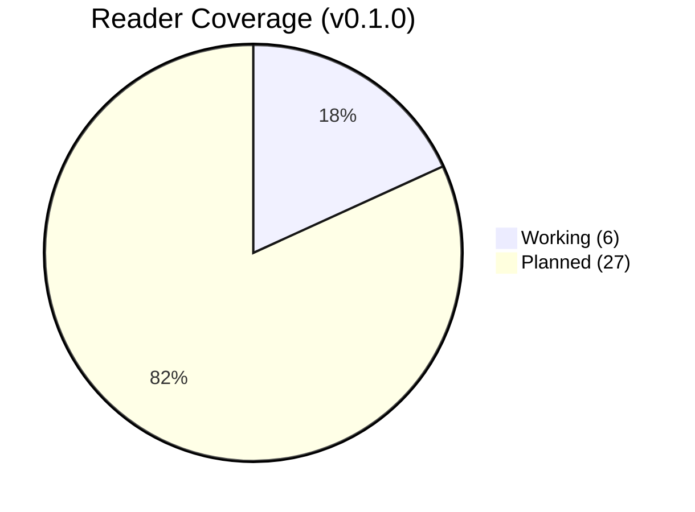
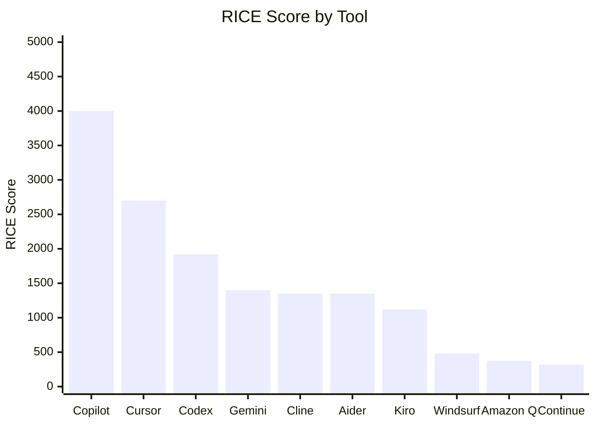

# AgentSON

**Release:** v1.2.0 (canonical schema, 2026-10-23)

**Release status:** Full session-debug (browser panel inspection), 236 passing tests, 9 readers.

**Implementation status:** ClickOps is not built; full MCP capture (ADR-022) remains design-only.

**Product boundary:** The AKCloud managed service is separate from AgentSON.

> *'Cause This is Exactly What Happens When an Agent + JSON Have a SON!*

```text
 ______                         __    ____    _____   __  __     
/\  _  \                       /\ \__/\  _`\ /\  __`\/\ \/\ \    
\ \ \L\ \     __      __    ___\ \ ,_\ \,\L\_\ \ \/\ \ \ `\\ \   
 \ \  __ \  /'_ `\  /'__`\/' _ `\ \ \/\/_\__ \\ \ \ \ \ \ , ` \  
  \ \ \/\ \/\ \L\ \/\  __//\ \/\ \ \ \_ /\ \L\ \ \ \_\ \ \ \`\ \ 
   \ \_\ \_\ \____ \ \____\ \_\ \_\ \__\\ `\____\ \_____\ \_\ \_\
    \/_/\/_/\/___L\ \/____/\/_/\/_/\/__/ \/_____/\/_____/\/_/\/_/
              /\____/                                            
              \_/__/                                             
```

> ⚠️ **Alpha, pre-release software.** This is not production-ready. Interfaces, the file format, and CLI commands can change without notice between versions. Known open design questions and gaps are tracked publicly at [github.com/andiekobbietks/AgentSON/issues](https://github.com/andiekobbietks/AgentSON/issues) — check there before depending on this for anything you can't afford to break. If you find a security issue, please open an issue or contact the maintainer directly rather than assuming it's already known.

**Preserve the operational life of an AI agent, independently of the runtime that hosted it.**

[](https://pypi.org/project/agentson/)
[](LICENSE)
[](https://pypi.org/project/agentson/)
[](https://github.com/andiekobbietks/AgentSON/actions)

> Nobody has done for agent session logs what OpenAPI did for REST APIs or what containers.dev did for dev environments.

---

## Why This Exists

This project started with a FreeStyle Libre 2 continuous glucose monitor.

Managing a chronic condition means your most personal data — blood glucose readings every 5 minutes, 24/7 — lives inside a vendor's app. Abbott's FreeStyle Libre app stores your data. It doesn't export to JSON. It doesn't integrate with your AI tools. It doesn't connect to your doctor's system without jumping through NHS FHIR hoops.

The same lock-in problem exists everywhere:

| Domain | Vendor | Data trapped |
|--------|--------|--------------|
| Health | Abbott (FreeStyle Libre 2) | Glucose readings, trends, reports |
| AI coding | OpenAI, Anthropic, Google | Session transcripts, reasoning traces |
| Development | Cursor, Copilot, Claude Code | Code context, edit history |

**GDPR Article 20** gives you the right to export your data in a machine-readable format. **The EU AI Act** requires transparency about AI-generated content. Most tools don't provide this. AgentSON does.

The FreeStyle Libre reader (`readers/libre.py`) was the first reader built — not because glucose data is the most important, but because it's the most personal. If the format can handle medical time-series data, it can handle anything.

> **Your health data. Your code sessions. Your data. One format.**

---

## The Problem

Every AI coding agent stores session data in its own proprietary database. There is no standard format, no export API, and no way to move context between tools. The data that powers AI training is locked inside vendor silos.

## The Solution

AgentSON captures the full trajectory of what happened during an AI-assisted session: prompts, thoughts, actions, code, observations, and outcomes — in one portable JSON file.

```
┌───────────────────────────────────────────────────────────────────┐
│                  Agent Runtime Layer (producers)                   │
├───────────────────────────────────────────────────────────────────┤
│  ┌─────────┐ ┌──────────┐ ┌──────────┐ ┌──────────┐ ┌─────────┐ │
│  │ OpenClaw│ │ClaudeCode│ │  Cursor  │ │ opencode │ │LangGraph│ │
│  └────┬────┘ └────┬─────┘ └────┬─────┘ └────┬─────┘ └────┬────┘ │
│  ┌────┴────┐ ┌────┴─────┐ ┌────┴─────┐ ┌────┴─────┐ ┌────┴────┐ │
│  │ CrewAI  │ │ AutoGen  │ │ OpenAI   │ │  Gemini  │ │  Cline  │ │
│  │         │ │          │ │ Agents   │ │   CLI    │ │  Aider  │ │
│  └────┬────┘ └────┬─────┘ └────┬─────┘ └────┬─────┘ └────┬────┘ │
│       │           │            │           │             │       │
│       ▼           ▼            ▼           ▼             ▼       │
│  ┌─────────────────────────────────────────────────────────────┐ │
│  │                   .AgentSON Files (Open Spec)               │ │
│  │               Portable, vendor-neutral, file-based          │ │
│  └───────────────────────────┬─────────────────────────────────┘ │
│                              │                                    │
│               ┌──────────────┼──────────────┐                   │
│               ▼              ▼              ▼                   │
│  ┌─────────────────┐ ┌──────────────┐ ┌──────────────────┐    │
│  │   Local CLI     │ │   Supabase   │ │  Web Viewer      │    │
│  │  (search/replay)│ │  (optional)  │ │  (shared replay) │    │
│  └─────────────────┘ └──────────────┘ └──────────────────┘    │
│                                                                   │
└───────────────────────────────────────────────────────────────────┘
```

---

## Tool Landscape

AgentSON covers the entire AI coding ecosystem — 33 tools across 7 tiers.

### Reader Coverage



### RICE Priority (Top 10 Readers)



> This chart excludes shipped readers. The displayed scores are provisional inherited estimates; see [ROADMAP.md](ROADMAP.md) for the scoring rules and evidence gaps.

### Tier 1: Core Market

| # | Tool | Type | Pricing | Traces | AgentSON |
|---|------|------|---------|--------|----------|
| 1 | **Cursor** | IDE | $20-40/mo | Richest (70% Fortune 1000) | 🔜 Planned |
| 2 | **Claude Code** | CLI | $20-200/mo | Deep reasoning (~$2.5B run-rate) | ✅ **Working** |
| 3 | **Kiro** | IDE | Free-$200/mo | Spec-driven (structured by design) | 🔜 Planned |
| 4 | **Codex CLI** | CLI | $20-200/mo | GPT-5.5 (ChatGPT base) | 🔜 Planned |
| 5 | **Gemini CLI** | CLI | Free | 1M context (Apache 2.0) | 🔜 Planned |
| 6 | **Windsurf/Devin Desktop** | IDE | $15-200/mo | ACP protocol (Cognition) | 🔜 Planned |

### Tier 2: Open Source

| # | Tool | Type | Pricing | Traces | AgentSON |
|---|------|------|---------|--------|----------|
| 7 | **opencode** | CLI | Free (BYOK) | 147K stars, 6.5M devs | ✅ **Working** |
| 8 | **Cline** | VS Code ext | Free (BYOK) | 60K stars, 5M installs | 🔜 Planned |
| 9 | **Aider** | CLI | Free (BYOK) | 43K stars, MIT | 🔜 Planned |
| 10 | **Zed** | IDE | Free + API | ACP protocol, parallel agents | 🔜 Planned |
| 11 | **Goose** | CLI | Free (BYOK) | Apache 2.0, Block-backed | 🔜 Planned |
| 12 | **OpenHands** | Web+CLI | Free (BYOK) | MIT, autonomous SWE | 🔜 Planned |

### Tier 3: Extensions

| # | Tool | Type | Pricing | Traces | AgentSON |
|---|------|------|---------|--------|----------|
| 13 | **GitHub Copilot** | Multi-IDE | $10-39/mo | Widest reach (5M+ users) | 🔜 Planned |
| 14 | **Amazon Q** | Extension | $19/user | AWS-native, enterprise | 🔜 Planned |
| 15 | **JetBrains AI** | Built-in | $10/mo | 31% market share | 🔜 Planned |
| 16 | **Sourcegraph Cody** | Extension | Free-$9/mo | Large codebase nav | 🔜 Planned |
| 17 | **Qodo** | Extension | Free-$19/mo | Code review specialist | 🔜 Planned |
| 18 | **Augment Code** | Extension | $20-60/mo | 200K context window | 🔜 Planned |
| 19 | **Continue** | Extension | Free | Open-source, self-hosted | 🔜 Planned |
| 20 | **Tabnine** | Extension | $12/mo | Privacy-focused, on-premise | 🔜 Planned |

### Tier 4: Builders

| # | Tool | Type | Pricing | Traces | AgentSON |
|---|------|------|---------|--------|----------|
| 21 | **Bolt.new** | Browser | Free-$20/mo | Prompt→deploy | 🔜 Planned |
| 22 | **v0** | Browser | Free-$20/mo | UI generation | 🔜 Planned |
| 23 | **Lovable** | Browser | Free-$20/mo | Full-stack apps | 🔜 Planned |
| 24 | **Replit** | Browser IDE | Free-$25/mo | Full environment | 🔜 Planned |

### Tier 5: Orchestrators

| # | Tool | Type | Pricing | Traces | AgentSON |
|---|------|------|---------|--------|----------|
| 25 | **amux** | Web+PWA | Free (BYOK) | 20-50+ parallel agents | 🔜 Planned |
| 26 | **Claude Squad** | TUI | Free (BYOK) | MIT, 10-20 agents | 🔜 Planned |
| 27 | **Kilo Code** | IDE panel | Free-$199/mo | Apache 2.0 | 🔜 Planned |
| 28 | **dmux** | Terminal | Free (BYOK) | MIT | 🔜 Planned |

### Tier 6: Autonomous

| # | Tool | Type | Pricing | Traces | AgentSON |
|---|------|------|---------|--------|----------|
| 29 | **Devin** | Cloud SaaS | $20-500+/mo | Fully autonomous | 🔜 Planned |
| 30 | **Blitzy** | Cloud SaaS | Enterprise | Enterprise SWE | 🔜 Planned |

### Tier 7: China Plans

| # | Tool | Type | Pricing | Traces | AgentSON |
|---|------|------|---------|--------|----------|
| 31 | **GLM Coding** | Desktop+CLI | Subscription | GLM-5.2 | ⏸ Deferred |
| 32 | **Kimi** | CLI | Cheap | Cost leader | ⏸ Deferred |
| 33 | **Qwen Code** | CLI | Cheap | Growing in Asia | ⏸ Deferred |

---

## Why AgentSON Matters

### The Unsloth Analogy

Unsloth democratized model fine-tuning. AgentSON democratizes data ownership.

| Before | After |
|--------|-------|
| GPU cluster + PhD needed | Single GPU, hours |
| No export API, vendor lock-in | One CLI command, portable JSON |
| Big labs only | Everyone |

### But It's Locked In

| Tool | Exports data? | Portable? | Trainable? |
|------|--------------|-----------|------------|
| Cursor | No | No | No |
| Claude Code | No | No | No |
| Copilot | Partial (API) | No | No |
| **AgentSON** | **Yes (JSON)** | **Yes** | **Yes** |

### For Developers

Your AI work across every runtime — OpenClaw, Claude Code, Cursor, opencode, Aider, Cline, Gemini CLI — becomes one searchable, portable, analysable record. Switch runtimes without losing your operational history. Every `.AgentSON` file is a personal engineering journal that follows you.

- **Portability** — Switch tools without losing context
- **Search** — Full-text search across all your sessions
- **Replay** — Re-run or review any agent session offline
- **Ownership** — No telemetry, no vendor lock-in, no cloud dependency

### For the Organisation

As AI agents become long-lived team members (Claude Tag, persistent agents), organisations will need to answer: what did this agent do over the last six months? Why did it make this decision? Can we migrate it to another platform? Can we audit its behaviour? Can we learn from its successful workflows?

Memory systems (MCP, bespoke databases) don't give you portable answers to those questions. AgentSON does.

- **Institutional knowledge** — Preserve the operational life of every agent independently of where it ran
- **Vendor independence** — Change runtimes, keep the record
- **Compliance** — GDPR Art. 20 + EU AI Act Art. 52
- **Training-data export** — Export to Unsloth/Olive for fine-tuning

---

## Market & Regulatory Positioning

AgentSON is designed as **vendor-neutral agent execution-history interoperability infrastructure**, not as a single-purpose compliance product. The same portable execution record can support several adjacent needs:

| Market | Organisational need | How AgentSON can help |
|---|---|---|
| AI agent developers and framework vendors | Export and inspect histories across runtimes | A common representation instead of framework-specific logs |
| Enterprise AI operations | Investigate failures, tool calls, decisions and incidents | Searchable, correlated records across agents and providers |
| Agent observability and evaluation | Compare runs and understand failures | Structured events with preserved provenance and semantics |
| AI training and dataset engineering | Turn execution histories into reusable datasets | Trace extraction with explicit transformation and loss accounting |
| Multi-agent orchestration | Understand interactions and handoffs | Correlated events, agent identities and handoff records |
| AI platform migration | Move between providers, frameworks and environments | A portable record independent of the originating runtime |
| Research and reproducibility | Reconstruct experimental execution histories | Evidence of event sequences, model metadata and observations |
| AI governance and assurance | Support audits and investigations | Traceability and provenance for downstream governance processes |

These are applications of the same underlying interoperability layer, not separate products or claims that every capability is already implemented.

### EU AI Act: a strong regulatory use case

Article 12 of the EU AI Act is a particularly relevant use case. It requires high-risk AI systems to technically allow the automatic recording of events (logs) over the system's lifetime. The logs are intended to support the identification of situations that may result in risk, post-market monitoring, and monitoring of system operation by deployers.

AgentSON's structured, portable execution histories could support organisations building the logging, inspection and evidence workflows needed for these purposes. Capturing event types, timestamps, correlations, source provenance and transformation history can make records more useful across tools and runtime environments.

**Article 12 does not mandate AgentSON or a universal interchange format.** Nor does a valid AgentSON export, by itself, establish compliance. Suitability depends on the AI system, the applicable requirements, the events actually captured, and the surrounding implementation and organisational controls. Relevant considerations can include logging completeness, integrity, access control, security, retention and lawful handling of personal data. Other provisions, including Article 19 and Article 26(6), address log retention responsibilities for providers and deployers respectively.

### Product positioning

- **Core product:** capture, correlate, preserve, search, export and exchange heterogeneous agent execution histories in a vendor-neutral representation.
- **Commercial applications:** developer tooling, observability, evaluation, debugging, migration, training-data preparation, multi-agent operations and research reproducibility.
- **Regulatory application:** support logging and evidence workflows for applicable requirements, with Article 12 as a particularly strong high-risk AI use case.

Regulation can create demand for reliable execution records without defining the limits of the infrastructure. AgentSON remains an interoperability project; it does not claim to provide regulatory certification or complete compliance.

---

## Agent Workspaces, Harnesses & Cloudflare OS

AgentSON is intended to preserve agent execution history across the environments in which agents are built, orchestrated and run. This includes individual coding harnesses, multi-agent frameworks, managed agent runtimes and organisational agent workspaces.

### Cloudflare OS as a future integration target

[Cloudflare OS](https://github.com/cloudflare/cloudflare-os) is a relevant reference implementation and potential integration target: an open platform for organisational agent workspaces, applications and controlled access to company resources. It is not itself a single agent harness. It sits above and alongside the runtimes, tools and services that agents use.

AgentSON's role would be complementary:

- **Cloudflare OS provides the workspace and execution environment.** It can organise agent work, connect tools and resources, and apply its own runtime and access-control model.
- **AgentSON provides a portable record.** It aims to capture and preserve the operational history of agents, tools, handoffs and outcomes in a vendor-neutral format that can be inspected and used outside the originating environment.
- **OpenTelemetry remains an important observability integration.** AgentSON should interoperate with existing traces and instrumentation rather than present itself as a replacement for OpenTelemetry or a platform's native tracing.

The intended outcome is that an organisation could retain useful AgentSON records when it changes agent workspaces, harnesses, model providers or execution infrastructure. Cloudflare OS is one prospective environment in that wider ecosystem, not a required dependency.

### Integration direction (planned; not implemented)

A future Cloudflare integration should be developed as an adapter, with capability discovery and explicit versioning rather than assumptions about undocumented internals.

| Integration area | Potential AgentSON treatment |
|---|---|
| Agent and workspace lifecycle | Record starts, completions, failures, cancellations and relevant workspace identifiers |
| Harness and model activity | Preserve model/provider metadata, run identifiers and available execution context |
| Tool calls and results | Represent calls, results, errors and correlation identifiers as linked events |
| Agent delegation and handoffs | Preserve source agent, destination agent, parent/child relationships and handoff outcome |
| OpenTelemetry traces | Import or correlate supported spans while retaining trace/span IDs and source attributes |
| Resource access and policy decisions | Record available authorisation, approval and resource-observation evidence with its source and limitations |
| Artifacts and outputs | Reference outputs and content digests where available; avoid silently copying secrets or sensitive payloads |

**Important boundaries**

1. Cloudflare OS integration is a future direction. AgentSON does not currently claim a native Cloudflare OS adapter, automatic Gatekeeper-event capture, or complete Cloudflare Agents tracing support.
2. Capture must use supported extension points, documented APIs, export mechanisms or OpenTelemetry interfaces. It must not depend on scraping private databases or undocumented implementation details.
3. An imported span or platform event is evidence of what the source instrumented and exposed; it is not proof that every internal agent action was captured.
4. Preserve source provenance, original identifiers, timestamps, event semantics and transformation metadata. Where conversion loses information, record that loss rather than implying a lossless translation.
5. Apply data minimisation and redaction before export. Prompts, tool arguments, resource identifiers and outputs may contain credentials, personal data or confidential organisational information.
6. AgentSON records can support investigation, evaluation and assurance workflows, but do not by themselves prove policy compliance, security or regulatory conformity.

### Suggested integration sequence

1. **Define the mapping:** document how supported Cloudflare Agents / OpenTelemetry events map to the canonical AgentSON v1.2 model, and identify fields that require a schema extension or a later schema version.
2. **Build a read-only proof of concept:** ingest a small, documented trace or exported event set and produce validated AgentSON output without changing the source workspace.
3. **Test fidelity:** verify correlation across agent runs, model calls, tool executions, errors and handoffs; test missing fields, retries, clock differences and partial traces.
4. **Validate privacy and security:** add redaction, secret handling, access controls and retention guidance before handling real organisational data.
5. **Publish an adapter and fixtures:** release reproducible examples and compatibility tests so the integration remains independently usable and maintainable.

The architectural principle is simple: **the platform may execute and observe the agent; AgentSON should help make the resulting operational record portable.**

---

## Quick Start

```bash
# Install
pip install agentson

# List sessions
agentson list --tool opencode

# Export a session
agentson export --tool opencode --session ses_xxx --output ./sessions/

# Fine-tuning export (Unsloth format)
agentson finetune *.AgentSON --format unsloth --output training.jsonl

# Search across sessions
agentson search "nightscout" --tool opencode

# Render as Markdown
agentson render session.AgentSON --format md

# Validate against the canonical schema
agentson validate ./sessions/
```

---

## Schema (v1.2 — canonical)

> v1 and v1.1 are deprecated. v1.2 is the canonical schema
> (`spec/v1.2.json`); individual entries validate against
> `spec/v1.2-entries.json`.

```json
{
  "$schema": "https://agentson.dev/schema/v1.2.json",
  "id": "session-2026-07-04-001",
  "task": "Fix the authentication bug in the login flow",
  "outcome": "success",
  "tool": {"name": "opencode", "session_id": "ses_xxx"},
  "agent": {"name": "mimo-v2.5-free", "provider": "opencode"},
  "entries": [
    {"type": "user-query", "text": "Fix the auth bug"},
    {"type": "thought", "text": "Looking at the auth module..."},
    {"type": "action", "tool": "bash", "code": "grep -r 'auth' src/", "tool_call_id": "tc_001"},
    {"type": "observation", "text": "Found 3 files", "correlation_id": "tc_001"},
    {"type": "answer", "text": "Fixed the null check in auth.py"}
  ]
}
```

### Entry Types

| Type | Description |
|------|-------------|
| `stream-meta` | Session header; first entry of a JSONL stream |
| `user-query` | User's input or question |
| `thought` | Agent's reasoning |
| `action` | Tool execution (code + output) |
| `observation` | Reading from a tool, user, system or sensor |
| `answer` | Agent's response |
| `side-effect` | File change or state mutation |
| `user-feedback` | User's reaction or correction |
| `system-event` | Runtime or system signal |
| `capabilities` | What the agent can do |
| `handoff` | Transfer of control between agents |
| `presence` | An agent joining or leaving |

---

## Fine-Tuning Export

```bash
# Unsloth/ShareGPT format (for LLaMA, Mistral, etc.)
agentson finetune *.AgentSON --format unsloth --output train.jsonl

# Olive format (Microsoft Olive pipeline)
agentson finetune *.AgentSON --format olive --output train.jsonl
```

Example output:
```json
{
  "conversations": [
    {"from": "human", "value": "How do I fix the auth bug?"},
    {"from": "gpt", "value": "I'll look at the auth module..."}
  ],
  "source": "opencode",
  "session_id": "ses_xxx"
}
```

---

## PWA Viewer

Open `pwa/index.html` in a browser, drag-and-drop an `.AgentSON` file. Works offline.

Full-featured web viewer at `docs/viewer/`: validation, download, search, sort, side-by-side layout, role-based colors.

---

## Repository Structure

```
agentson/
├── spec/
│   ├── v1.json              # JSON Schema v1 (deprecated)
│   ├── v1.1.json            # JSON Schema v1.1 (deprecated)
│   ├── v1.2.json            # JSON Schema v1.2 (canonical)
│   └── v1.2-entries.json    # v1.2 per-entry validator
├── readers/                 # Tool-specific readers
│   ├── opencode.py          # ✅ Working
│   ├── minimax.py           # ✅ Working
│   ├── antigravity.py       # ✅ Working
│   ├── libre.py             # ✅ Working (FreeStyle Libre 2)
│   ├── chrome_devtools.py   # ✅ Working (9 tests)
│   └── claude_code.py       # ✅ Working
├── importers/
│   └── chatgpt.py           # ✅ ChatGPT conversations.json
├── exporters/
│   └── finetune.py          # ✅ Unsloth + Olive formats
├── cli/
│   ├── main.py              # CLI entry point
│   └── supabase_client.py   # Supabase integration
├── tests/
│   └── test_chrome_devtools.py  # ✅ 9 tests
├── examples/                # Example .AgentSON files
├── pwa/                     # PWA viewer
├── docs/                    # Live docs + viewer
│   ├── viewer/              # Web viewer
│   ├── sops/                # 14 SOPs
│   ├── standards/           # Operating manual + ADRs
│   └── index.html           # Landing page
├── STRATEGIC_ROADMAP.md               # Strategic roadmap: operational evidence, incident reconstruction, interoperability
├── ROADMAP.md               # RICE-scored reader priorities
├── CHANGELOG.md             # Version history
├── PRD.md                   # Product requirements
└── LICENSE                  # Apache 2.0
```

---

## Roadmap

See [STRATEGIC_ROADMAP.md](STRATEGIC_ROADMAP.md) for the expanded strategic and engineering roadmap, including the proposed extension from AI-agent session portability into human-operated IT operations, OpenTelemetry interoperability, incident reconstruction, cross-provider evidence and recovery assurance. The November 2026 Microsoft 365 incident is documented there as a motivating case study, not as proof that Microsoft lacks observability tooling or that these proposed capabilities are already implemented.

See [ROADMAP.md](ROADMAP.md) for the existing RICE-scored reader priorities across the AI coding-tool landscape.

**Next readers:** OpenClaw, Cursor, Cline, Aider, Gemini CLI, Copilot

**Version targets:**
- v0.2.0 (Aug 2026): 10+ readers, real-world data
- v0.3.0 (Sep 2026): 15+ readers, sample corpus
- v1.0.0 (Oct 2026): 20+ readers, stable API

---

## Standards

- [Operating Manual](https://andiekobbietks.github.io/AgentSON/standards/) — Mental models, coding standards, workflow rules
- [ADRs](https://andiekobbietks.github.io/AgentSON/standards/) — Architecture Decision Records (11 ADRs)
- [SOPs](https://andiekobbietks.github.io/AgentSON/sops/) — 14 Standard Operating Procedures

---

## License

[Apache 2.0](LICENSE) — Patent grant + attribution required.

---

*"The operational life of an AI agent, preserved independently of the runtime that hosted it."*

## Project governance and contribution

- [Project Charter](PROJECT_CHARTER.md) — purpose, scope, status vocabulary and continuation principles
- [Contributing](CONTRIBUTING.md) — contribution workflow, schema changes and pull request expectations
- [Security Policy](SECURITY.md) — responsible vulnerability reporting
- [Code of Conduct](CODE_OF_CONDUCT.md) — community participation expectations
- [Support](SUPPORT.md) — where to ask questions and report problems
- [Citation metadata](CITATION.cff) — how to cite AgentSON in research and software
